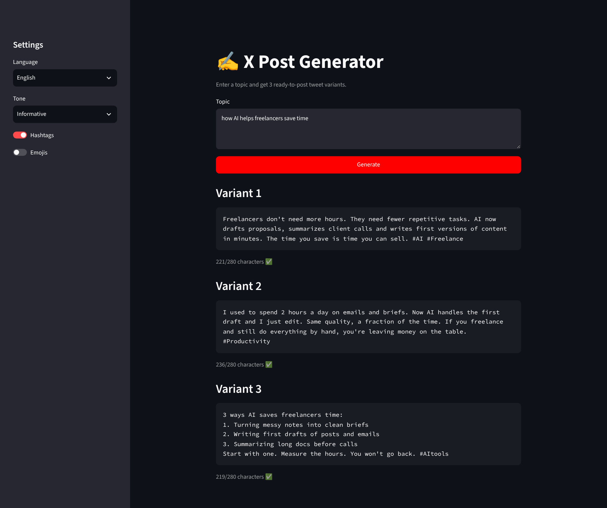

# ✍️ X Post Generator

A small Streamlit app that turns any topic into **3 ready-to-post tweet variants** using the Claude API.



## Features

- 3 different post variants per topic, each with its own hook
- Languages: English, Ukrainian, Polish
- Tone selector: informative, funny, provocative, motivational, storytelling
- Optional hashtags and emojis
- Character counter with a 280-character check
- One-click copy for every post

## Tech stack

- Python 3.10+
- [Streamlit](https://streamlit.io/) for the UI
- [Anthropic Python SDK](https://github.com/anthropics/anthropic-sdk-python) for text generation

## Getting started

```bash
git clone https://github.com/<your-username>/x-post-generator.git
cd x-post-generator

python -m venv .venv
source .venv/bin/activate      # Windows: .venv\Scripts\activate

pip install -r requirements.txt
cp .env.example .env           # then paste your API key into .env

streamlit run app.py
```

The app opens at `http://localhost:8501`. You can also paste the API key directly in the sidebar instead of using `.env`.

## How it works

1. The app builds a prompt from the topic, language, tone and options.
2. Claude returns a JSON array with 3 posts.
3. The app parses the response, shows each post with a character count and flags anything over 280 characters.

## Ideas for next versions

- Thread mode (generate a 5-tweet thread)
- Save favorite posts to a local history
- Post directly to X via the API

## Author

STUDIO GOLD · Telegram [@aiceks](https://t.me/aiceks)
